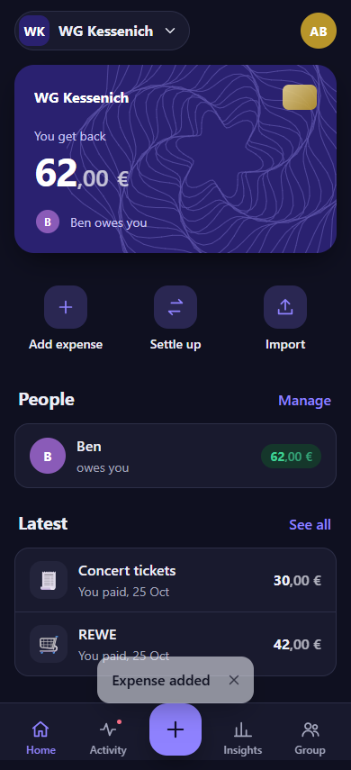
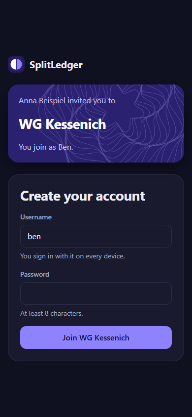
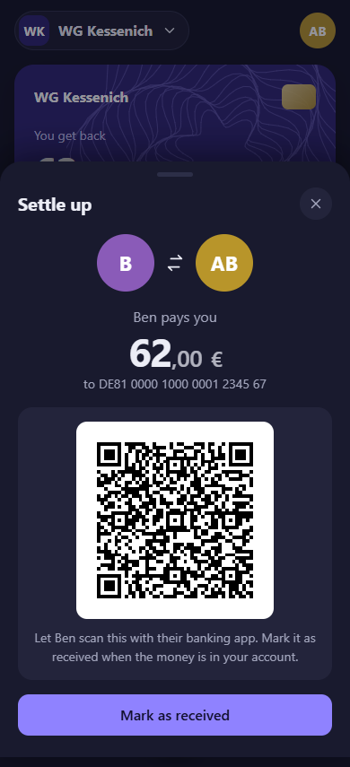
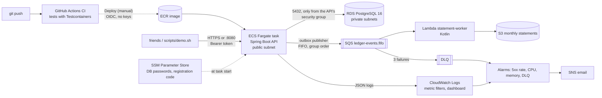

# SplitLedger

My friends and I share costs and track them in Splitwise. Every shared payment already exists in
someone's German bank account, yet it has to be typed in again by hand; settling up means copying
IBANs into a banking app; any entry can be edited or deleted later without a trace; and searching
the history ("what did we pay for the Berlin trip?") needs the paid plan.

SplitLedger is a small ledger service for one group of friends that fixes exactly that:

1. **Import instead of typing.** Upload your bank statement export; outgoing payments become
   expense candidates only you can see, and importing the same or an overlapping file never
   creates duplicates (two identical coffees on one day stay two).
2. **History nobody can quietly rewrite.** Anyone in the group can edit or delete an expense or
   undo a payment, but nothing is overwritten: underneath it is an append-only, double-entry
   ledger where a change is a reversing entry plus the new version, the old one stays visible with
   who changed it, PostgreSQL rejects UPDATE and DELETE, and a SHA-256 hash chain shows if someone
   with database access changed anything.
3. **Search the whole history, free.** German word forms ("Einkauf" finds "Einkäufe"), typos
   ("Pizerria") and filters, on PostgreSQL full-text and trigram indexes.
4. **Settle with a scan.** "You owe Lucy 10,00 €" comes with a GiroCode (EPC QR) that German
   banking apps scan; recording the payment updates the ledger.
5. **Join with a link.** A friend opens the invite link from WhatsApp, picks a username and a
   password and is in the group; a forgotten password is fixed with a reset link from a groupmate.
6. **See where the money goes.** Categories (suggested from the payee: "REWE" is groceries),
   monthly insights with your own share, and an activity feed of who added, paid or changed what.

Friends use it as a web app on their phones (installable to the home screen) or on a laptop,
served by the same service.

<p>
  
  
  
</p>

It is a personal project for a group of friends, not a payment service: no money is moved and no
bank API is called. Deployed and verified on AWS; the stack is torn down between demos.

## Architecture



Everything on AWS is created by Terraform (`infra/`): VPC without NAT gateway, RDS, ECR, ECS,
SQS, Lambda, S3, CloudWatch, SSM, IAM (least privilege, including the GitHub OIDC deploy role) and
a budget alert. Every expense, reversal and payment also writes an event through a transactional
outbox; a Kotlin Lambda turns the events into one JSON statement per group and month in S3.
Passwords are generated by ephemeral resources and never stored in the Terraform state. The
application connects to PostgreSQL as a role that can only read and insert, and change the few
mutable tables. The reasoning behind each choice is in [docs/decisions.md](docs/decisions.md);
dated evidence of what ran is in [docs/verification.md](docs/verification.md).

| Area | Technology |
|---|---|
| Service | Java 21, Spring Boot 4.1, Spring Security (API tokens), Spring Data JPA, Flyway, springdoc-openapi |
| Worker | Kotlin 2.4, kotlinx.serialization, AWS Lambda (java21, arm64), AWS SDK v2 |
| Data | PostgreSQL 16: `tsvector` + GIN, `pg_trgm`, triggers, row locks, partial unique indexes |
| Web app | React 19, TypeScript, Vite, no UI or chart library; installable (manifest, service worker that never caches API data); served by Spring Boot from the same origin, strict Content-Security-Policy |
| Tests | JUnit, Testcontainers (PostgreSQL, ElasticMQ for SQS, S3Mock), concurrency tests, Vitest, a Playwright browser walkthrough in CI; 199 API + 13 worker + 62 web tests |
| Infrastructure | Terraform 1.16, AWS provider 6: VPC, RDS, ECR, ECS Fargate, SQS, Lambda, S3, SSM, IAM, CloudWatch, SNS, Budgets |
| Delivery | GitHub Actions (CI on every push, deploy via OIDC), Docker multi-stage image, non-root |

## Run locally

Requirements: Java 21 and Docker. Maven is not needed; the wrapper `./mvnw` downloads the pinned version.

```bash
cp .env.example .env          # then set your own passwords
docker compose up --build     # API on http://localhost:8080, PostgreSQL on 127.0.0.1:5432 (DB_PORT in .env)
scripts/demo.sh               # the whole story: two friends, imports, settle-up, verify, search
```

The web app is at http://localhost:8080: "Start a new group" creates your account, then invite
friends from the Group page. Interactive API docs: http://localhost:8080/swagger-ui.html (register
with `POST /users`, then use the token with "Authorize"). Tests: `cd api && ./mvnw verify`.

## Deploy to AWS

Needs Terraform, the AWS CLI with a login (`aws login`) and Docker. Region `eu-central-1`.

```bash
terraform -chdir=infra/bootstrap apply   # once: monthly budget with email alerts
cp infra/app/terraform.tfvars.example infra/app/terraform.tfvars   # alarm email
(cd statement-worker && ./mvnw -B package)   # the Lambda jar Terraform uploads
terraform -chdir=infra/app apply         # network, database, registry, cluster (0 tasks), queues, Lambda
scripts/push-image.sh                    # first image, tagged with the git commit
terraform -chdir=infra/app apply -var api_image_tag=<tag> -var api_desired_count=1
```

After that, deployments run from GitHub: **Actions -> Deploy -> Run workflow**. The workflow waits
for CI on the commit, assumes the deploy role through OIDC, pushes the image, rolls the service
and smoke-tests it. Try it:

```bash
BASE_URL="$(scripts/aws-api-url.sh)" \
REGISTRATION_CODE="$(aws ssm get-parameter --name /splitledger/registration-code --with-decryption --query Parameter.Value --output text)" \
scripts/demo.sh
```

When done: `terraform -chdir=infra/app destroy` (the budget alert in `infra/bootstrap` stays).

## Costs

The AWS stack is for showing that it runs, not for permanent hosting. Approximate eu-central-1
prices:

| AWS part | While running | If left on for a month |
|---|---|---|
| RDS PostgreSQL `db.t4g.micro`, 20 GB gp3 | ~0.02 USD/h | ~16 USD |
| ECS Fargate 0.25 vCPU / 0.5 GB + public IPv4 | ~0.02 USD/h | ~14 USD |
| SQS, Lambda, S3 statements | free tier | ~0 USD |
| ECR, CloudWatch (logs, 4 alarms, 1 dashboard), SNS, SSM, IAM, Budgets | free tier | ~0 USD |
| **Total** | **~0.04 USD/h** | **~30 USD** |
| Avoided on purpose: NAT gateway / load balancer | | ~35 / ~20 USD |

A demo session (apply, deploy, verify, destroy) costs a few cents. The account runs on the AWS
Free plan (credits; the card is not charged), with a budget alert at 5 USD measured before credits.

Measured: the stack ran for about six hours of building and testing on 2026-10-22, roughly
0.30 USD, paid from the Free-plan credits.

**Everyday use with friends costs nothing:** run it on an Oracle Cloud "Always Free" VM or any
machine at home, as below. That split is the point: paying for hosting would defeat a project that
exists to avoid paying for Splitwise Pro.

## Free hosting for everyday use

`deploy/free-host/` runs the API, PostgreSQL and Caddy, which fetches a Let's Encrypt certificate,
so tokens only travel over HTTPS. Registration requires a code you share with your friends.

1. Get a free VM (for example Oracle Cloud Always Free, Ubuntu) and a domain pointing to it (a free
   DuckDNS name works). Open ports 80 and 443 in the VM's firewall and security list.
2. Install Docker, clone this repository, then:
   ```bash
   cd deploy/free-host
   cp .env.example .env      # DOMAIN, two database passwords, the registration code
   docker compose up -d --build
   ```
3. `BASE_URL=https://<your-domain> REGISTRATION_CODE=<code> scripts/demo.sh` checks it end to end.

On a machine at home you can skip the domain and the open ports: a free Cloudflare Tunnel
(`cloudflared`) forwards an HTTPS address to the API without exposing your network. Serverless
platforms such as Cloudflare Workers cannot run this service itself (a JVM with PostgreSQL).

Back up the database regularly, for example `docker compose exec db pg_dump -U splitledger splitledger > backup.sql`.

## API

Every request except registration, health and the API docs needs `Authorization: Bearer <token>`.
Everything under `/groups/{id}` is only for members of that group (403 otherwise).

| Method and path | Purpose |
|---|---|
| `POST /users`, `GET /me` | Register (returns the API token once); your groups |
| `POST /groups`, `GET /groups/{id}` | Create a group (you become its first member) and read it |
| `POST /groups/{id}/members`, `GET /groups/{id}/members` | Add a friend (returns a one-time invite code) and list members |
| `POST /invitations/accept` | Link your account to the member the invite code belongs to |
| `PUT /groups/{id}/members/me/bank-details` | Set your IBAN/BIC (validated with ISO 13616 mod-97) |
| `POST /groups/{id}/expenses` | Create an expense; requires an `Idempotency-Key` header |
| `GET /groups/{id}/expenses/{expenseId}` | Read an expense with its shares |
| `POST /groups/{id}/expenses/{expenseId}/reversal` | Delete: reversing entries cancel the expense (once); the history shows who |
| `POST /groups/{id}/expenses/{expenseId}/correction` | Edit: reverses the old version and creates the new one in one step (`Idempotency-Key`) |
| `GET /groups/{id}/expenses/search?q=&member=&from=&to=&min=&max=&limit=&cursor=` | Search descriptions, notes and bank purpose texts; filters; keyset pagination |
| `POST /groups/{id}/imports` | Upload your bank statement (multipart `file`); returns new / duplicate / skipped counts |
| `GET /groups/{id}/bank-transactions` | Your expense candidates (only you see your bank data) |
| `POST /groups/{id}/bank-transactions/{tid}/confirmation`, `.../ignore` | Share a candidate (payer, amount, date default to the bank's values), or drop it |
| `GET /groups/{id}/balances` | Net balance per member; positive means the group owes them |
| `GET /groups/{id}/debts` | Who owes whom, pair by pair (adds up to the balances) |
| `GET /groups/{id}/settlement` | The fewest transfers that settle everyone (greedy), with the receiver's IBAN |
| `GET /groups/{id}/settlement/girocode?from=&to=&amount=` | GiroCode PNG (EPC069-12) for a transfer between two members |
| `POST /groups/{id}/payments`, `GET /groups/{id}/payments` | Record a settle-up payment (`Idempotency-Key`) and list them |
| `POST /groups/{id}/payments/{paymentId}/reversal` | Undo a payment recorded by mistake (once); it stays listed as undone |
| `GET /groups/{id}/verify` | Recompute the hash chain; report the first broken entry and the head hash |

Amounts are integer cents. Split modes: `EQUAL`, `EXACT` (cents per person) and `SHARES` (units per
person). Errors are RFC 9457 problem details; every response carries an `X-Request-Id` that also
appears in the logs.

## Bank data: assumptions and privacy

- **The importer reads the Sparkasse "CSV-CAMT" export** from online banking (semicolon-separated,
  Windows-1252, decimal commas, `dd.mm.yy` dates, columns such as `Buchungstag`,
  `Verwendungszweck`, `Beguenstigter/Zahlungspflichtiger`, `Kontonummer/IBAN`, `Betrag`). It was
  first built against the published layout and then checked with a real export of my Sparkasse
  KölnBonn account (CSV-CAMT, 2026-10-23), which imported without changes. The files in
  `samples/` and the tests stay synthetic: invented names and IBANs with a bank code no German bank
  has. Real statements are never committed. The parser sits behind an interface so other banks
  (and ISO 20022 CAMT.053) can be added.
- Names and IBANs are personal data. The uploaded file is parsed in memory and never stored; incoming
  and pending payments are not stored at all. Outgoing payments wait as candidates that only the
  account owner can see. Confirming one makes it a shared expense; ignoring one deletes its
  counterparty and purpose text and keeps only a fingerprint, date and amount, so a re-import still
  recognizes it. Each member enters their own IBAN; nobody sets someone else's.

## Status

| Part | State |
|---|---|
| Ledger core, idempotent expenses, balances | done (day 1) |
| Hash chain, reversals, append-only enforcement, search | done (day 2) |
| API tokens and membership checks, Sparkasse CSV import, settle-up, OpenAPI, demo script | done (day 3) |
| AWS with Terraform, least-privilege IAM and database roles, budget alert | done (day 4) |
| GitHub OIDC deploy pipeline, JSON logs, CloudWatch alarms and dashboard, free-host setup | done (day 5) |
| Transactional outbox, SQS FIFO with DLQ, Kotlin Lambda writing monthly statements to S3 | done (day 6) |
| GiroCode, web page with splits, history, who owes whom; browser test in CI | done (day 7) |
| Edit, delete and undo with an audit trail; sharing a bank payment through the form; real Sparkasse export checked | done (2026-10-23) |
| CAMT.053 import; Lambda deployment through the pipeline; remote Terraform state | later |

The AWS stack was destroyed after the evidence was recorded; `infra/app` recreates it in about
ten minutes. "Used with friends" will only be claimed after a real month of use.
