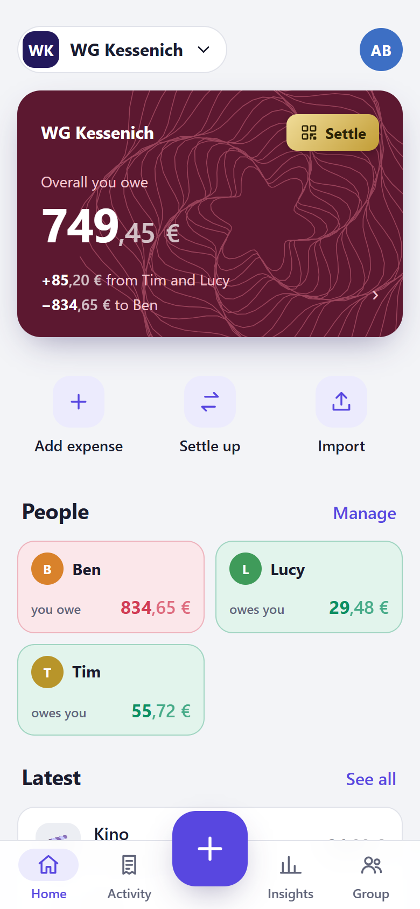
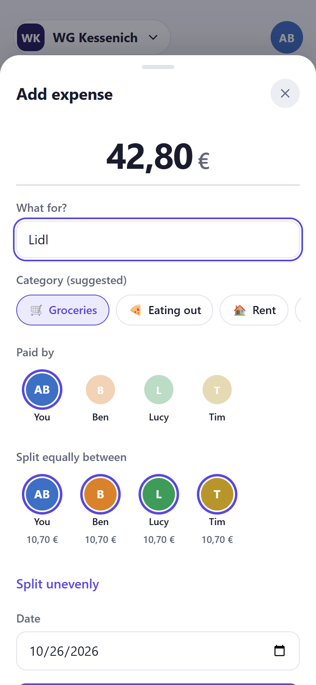
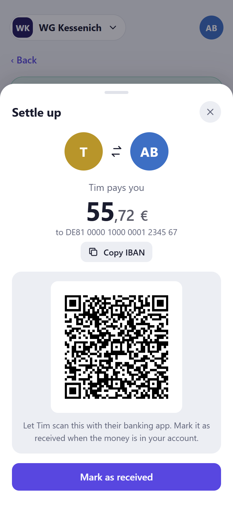
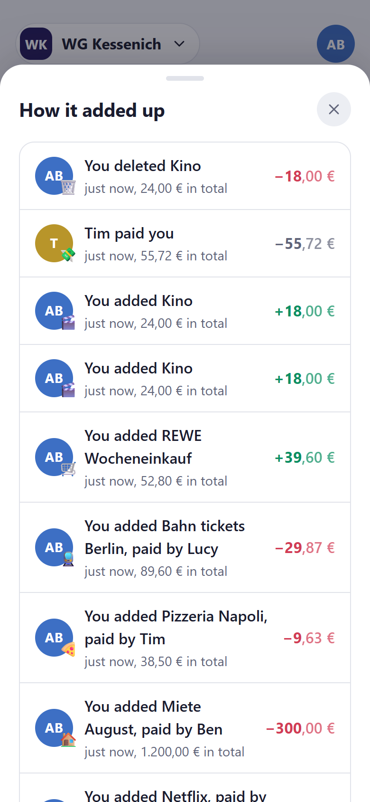
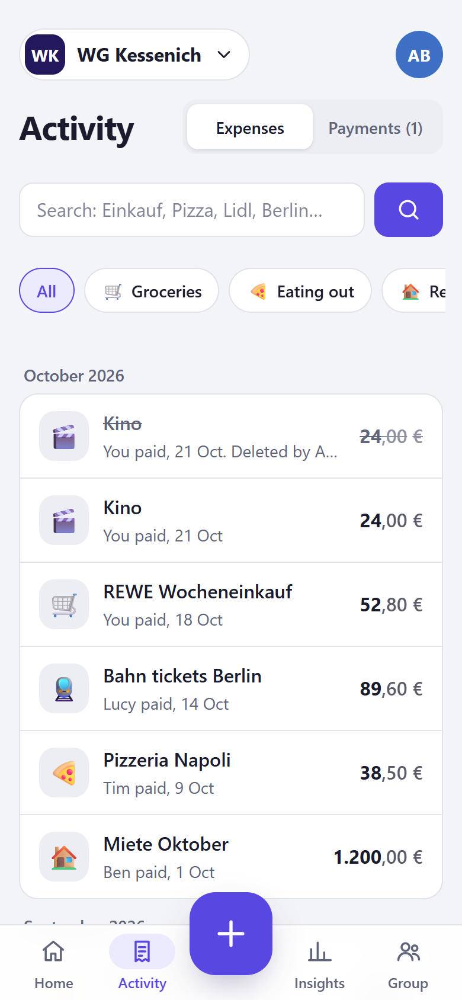
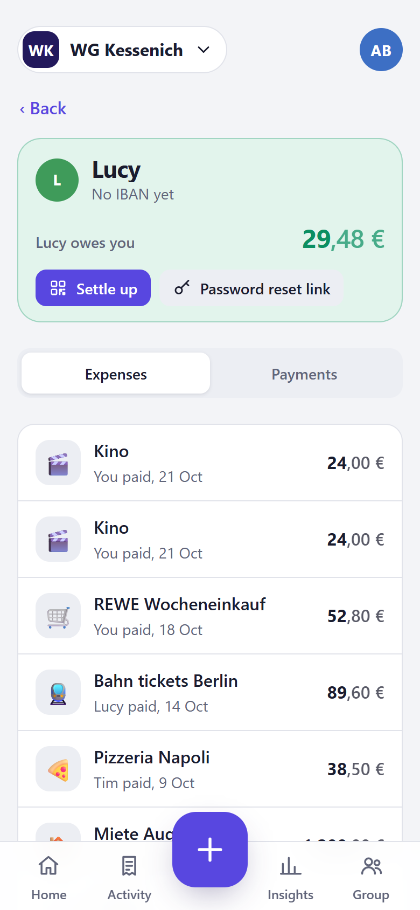
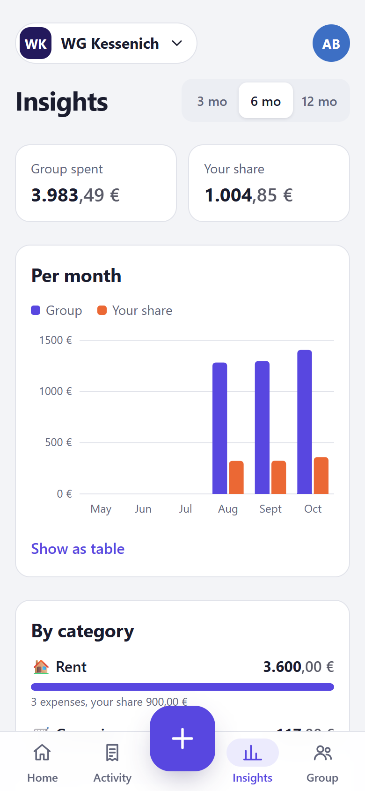
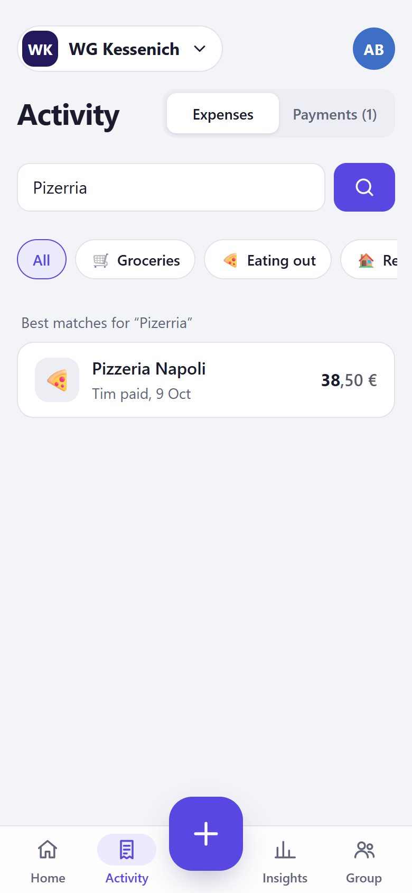
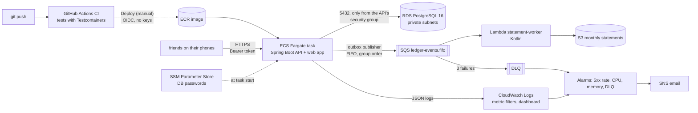

# SplitLedger

My flatmates and I split almost everything. Rent, groceries, the odd pizza night, train tickets to
Berlin. For a long time we used Splitwise, and three things about it kept bugging me.

Every shared payment already sat in somebody's bank account, and we still typed each one in again by
hand. Anyone could quietly edit or delete an old expense and nobody would ever know. And when it was
time to pay up, I was copying IBANs from a chat into my banking app, hoping I got the digits right.
Searching for "what did we pay for that Berlin trip?" needed the paid plan on top.

So I built my own. SplitLedger is a shared-expenses app for a group of friends that treats the money
the way a bank would: every change is recorded, nothing is ever overwritten, and settling up is one
scan in your banking app.

<p>
  
  
  
</p>

## What it does

**Import instead of typing.** I upload the CSV export from my online banking and every outgoing
payment shows up as a candidate that only I can see. I share the ones that were for the flat and
ignore the rest. Importing the same file twice, or one that overlaps last month's, adds nothing new,
and two identical coffees on the same day still count as two.

**Settle with a scan.** "Lucy owes you 29,48 €" comes with a GiroCode, the QR code German banking apps
read for transfers. Lucy scans it, finds name, IBAN, amount and reference already filled in, checks
and sends. If she'd rather type it, one tap copies the IBAN.

**A history nobody can rewrite.** Anyone can fix a mistake, but fixing never erases. Edit an
expense and the old version stays in the history, crossed out, with who changed it and when. The
home card opens a timeline of every expense and payment with what each one did to your balance, so
you can see exactly how you ended up owing 749,45 €.

**Search that understands German.** "Einkauf" finds "Einkäufe", a typo like "Pizerria" still finds
"Pizzeria Napoli", and you can filter by person, category, date or amount. Free, for the whole history.

**Joining takes ten seconds.** I add a friend by name and send them a link on WhatsApp. They pick a
username and password and they're in. Forgot your password? Anyone in your group can make you a
one-time reset link.

**It feels like an app.** It installs to the home screen, has a dark mode, categories that guess
themselves from the shop name (REWE is groceries, DB is transport), monthly insights with your own
share, and a page for every person showing where you two stand.

<p>
  
  
  
</p>
<p>
  
  
</p>

It's a personal project for friends, not a payment service. No money moves through it and it never
talks to a bank API. People pay each other the normal way and record it here.

## The parts I'm most proud of

### Money is a ledger, not a table you can edit

Underneath the friendly screens is an append-only, double-entry ledger. Every expense writes entries
that add up to zero: the payer is credited the full amount, everyone who shares it is debited their
part. Balances are never stored, they're always the sum of the entries.

Deleting an expense writes reversing entries. Editing one reverses the old version and books the new
one in a single transaction, so the group never sees both or neither. I didn't want this to rely on
my Java code behaving, so PostgreSQL enforces it too. Triggers reject `UPDATE` and `DELETE` on the
ledger, and the app connects as a database role that can only read and insert. On top of that, every
entry carries a SHA-256 hash of the one before it, so `GET /groups/{id}/verify` shows if anyone with
direct database access ever changed history.

Splitting 10,00 € three ways is a classic place to lose a cent. Amounts are integer cents
everywhere, the leftover cent goes to a fixed person (largest remainder, ties to the lower member id),
and the web app runs a port of the same algorithm so the preview always matches what gets saved.
That's checked against 5,000 random splits.

### Pressing "Add" twice books once

On a phone, a quick double tap can send the same request twice. Every create carries an
`Idempotency-Key`, and the server stores it with a hash of the request body. The same key returns the
first result instead of booking again, and the same key with a different body is refused. A
concurrency test fires sixteen threads at it with one key and gets exactly one expense.

I later found a hole in my own page. It generated a new key on every tap, so two taps looked like two
different requests. Now each form keeps one key for as long as it's open, and every button ignores
further taps while its action is running. Five fast taps on "Add" send one request.

### Bank import that respects privacy

Bank statements are personal data. The uploaded file is parsed in memory and never stored. Incoming
and pending payments are dropped right away. Outgoing ones wait as candidates that only the account
owner sees. Ignoring one deletes the payee and purpose text and keeps only a fingerprint, so a
re-import still recognises it. Duplicates are found by a fingerprint of date, amount, payee and
purpose plus an occurrence counter, which is what keeps those two identical coffees apart.

### Accounts that are easy for friends and hard for strangers

Friends sign in with a username and password (bcrypt). Every device gets its own session that can
be signed out on its own or all at once. Invite and reset codes travel in the URL fragment
(`#join=inv_…`), which browsers never send to the server, so they never land in a log. Sign-up is
open, but one network can create at most five accounts an hour, and every group is visible to its
members only, checked in one central rule before any controller runs.

### Built to run in the cloud, and to cost nothing day to day

The whole AWS setup is Terraform: VPC, RDS PostgreSQL, ECS Fargate, ECR, SQS, Lambda, S3,
CloudWatch, SSM and least-privilege IAM. GitHub Actions deploys through OIDC, so there are no AWS keys
anywhere. I skipped the NAT gateway and the load balancer on purpose, which saves about 55 USD a
month. Database passwords come from ephemeral resources and never touch the Terraform state.

Every expense, reversal and payment also writes an event through a transactional outbox. A
publisher sends them to an SQS FIFO queue (one message group per expense group, so order holds), and
a small Kotlin Lambda turns them into a monthly statement per group in S3. Failures go to a
dead-letter queue with a CloudWatch alarm.

Running all of that permanently would cost about 30 USD a month, which defeats the point of a
project that exists so we don't pay for Splitwise Pro. So the app has two homes. On AWS I deploy,
verify and tear it down again (a full demo session costs a few cents). For everyday use it runs on a
free Oracle Cloud VM with Docker Compose and Caddy, which handles HTTPS by itself.



### Tested like it handles money

204 API tests run against a real PostgreSQL in Testcontainers, including the append-only rules, the
database role's privileges, race conditions and an `EXPLAIN` check that search really uses its
indexes on 50,000 expenses. The Kotlin worker has 13 tests against an SQS emulator and S3Mock, and
the web app 79 unit tests. On every push, CI also builds the Docker image and runs a browser
walkthrough in real Chrome: three friends in separate browsers, one invites, one joins by link, one
signs up and pastes the link, then expenses, a bank import, a GiroCode, corrections and the final
balances, on a desktop in light mode and a phone in dark mode.

## Things that bit me along the way

- The first AWS demo ran over plain HTTP, and adding an expense failed there while it worked
  perfectly on my laptop. `crypto.randomUUID()` only exists on secure pages, so I build the
  idempotency key from `crypto.getRandomValues()` when it's missing, with a test that simulates it.
- PostgreSQL's `sum()` over a `bigint` column returns `numeric`, not `bigint`. Inside a `UNION`
  that turned a perfectly good query into a type error.
- After a tap on a phone, Chrome fires a "mouse leave" event, which closed my chart tooltip the
  moment it opened. And lifting a finger after a long press sends a click to whatever is now under
  it, which was the dimmed backdrop of the menu that had just opened, so it closed again at once.
- The activity feed mixed timestamps from Java and from the database container. A few milliseconds
  of clock drift were enough to shuffle the order, so now everything takes its time from one clock.

## Tech

| Area | What I used |
|---|---|
| Service | Java 21, Spring Boot 4.1, Spring Security, Spring Data JPA, Flyway, springdoc-openapi |
| Data | PostgreSQL 16 with `tsvector` + GIN, `pg_trgm`, triggers, row locks, partial unique indexes |
| Web app | React 19, TypeScript and Vite, with no UI, router or chart library. Installable, with a service worker that never caches API data, served from the same origin under a strict Content-Security-Policy |
| Worker | Kotlin 2.4, kotlinx.serialization, AWS Lambda (java21, arm64), AWS SDK v2 |
| Infrastructure | Terraform 1.16 with the AWS provider 6, Docker Compose and Caddy for the free host |
| Delivery | GitHub Actions (tests on every push, deploys through OIDC), multi-stage Docker image running as non-root |
| Tests | JUnit 5, Testcontainers (PostgreSQL, ElasticMQ, S3Mock), Vitest, playwright-core |

Why I chose each of these, and what I decided against, is written down in
[docs/decisions.md](docs/decisions.md). What actually ran, with dates and output, is in
[docs/verification.md](docs/verification.md).

## Run it yourself

You need Java 21 and Docker. Maven isn't needed, the wrapper downloads the pinned version.

```bash
cp .env.example .env          # set your own passwords
docker compose up --build     # app on http://localhost:8080
scripts/demo.sh               # the whole story through the API: two friends, imports, settle-up, search
```

Open http://localhost:8080, create an account, start a group and invite yourself from a second
browser. The API docs are at http://localhost:8080/swagger-ui.html. Tests: `cd api && ./mvnw verify`,
`cd web && npm test`.

### Host it for your friends for free

`deploy/free-host/` runs the app, PostgreSQL and Caddy, which fetches a Let's Encrypt certificate
by itself.

1. Get a free VM (I use Oracle Cloud Always Free with Ubuntu) and a domain pointing at it. A free
   DuckDNS name works fine. Open ports 80 and 443.
2. Install Docker, clone this repository, then:
   ```bash
   cd deploy/free-host
   cp .env.example .env      # your domain and two database passwords
   docker compose up -d --build
   ```
3. Updating later is `git pull && docker compose up -d --build`. New database migrations run when
   the app starts, so take a backup first:
   `docker compose exec db pg_dump -U splitledger splitledger > backup.sql`.

Sign-up is open by default. Set `REGISTRATION_CODE` in `.env` if you'd rather have people enter a
code first (invite links always work without it).

If you lock yourself out and nobody in your group can make you a reset link, you can make one on the
server. It's the same one-time link the app creates, with only its hash stored:

```bash
docker compose exec -T db psql -U splitledger -d splitledger -c "select id, display_name from app_user;"
CODE="rst_$(openssl rand -base64 32 | tr '+/' '-_' | tr -d '=\n')"
HASH=$(printf '%s' "$CODE" | sha256sum | cut -d' ' -f1)
docker compose exec -T db psql -U splitledger -d splitledger -c \
  "insert into password_reset (user_id, group_id, created_by_member_id, code_hash, expires_at)
   select m.user_id, m.group_id, m.id, '$HASH', now() + interval '1 hour' from member m where m.user_id = <id> limit 1;"
echo "https://<your-domain>/#reset=$CODE"
```

### Deploy it to AWS

You need Terraform, the AWS CLI with a login (`aws login`) and Docker. Everything goes to
`eu-central-1`.

```bash
terraform -chdir=infra/bootstrap apply   # once: a monthly budget with email alerts
cp infra/app/terraform.tfvars.example infra/app/terraform.tfvars   # your alarm email
(cd statement-worker && ./mvnw -B package)   # the Lambda jar Terraform uploads
terraform -chdir=infra/app apply         # network, database, registry, cluster, queues, Lambda
scripts/push-image.sh                    # the first image, tagged with the git commit
terraform -chdir=infra/app apply -var api_image_tag=<tag> -var api_desired_count=1
```

After that, deployments run from GitHub under **Actions, Deploy, Run workflow**. The workflow waits
for CI on that commit, assumes the deploy role through OIDC, pushes the image, rolls the service
and smoke-tests it. When you're done, `terraform -chdir=infra/app destroy` removes everything except
the budget alert.

What it costs in `eu-central-1`:

| AWS part | While running | Left on for a month |
|---|---|---|
| RDS PostgreSQL `db.t4g.micro`, 20 GB gp3 | ~0.02 USD/h | ~16 USD |
| ECS Fargate 0.25 vCPU / 0.5 GB and a public IPv4 | ~0.02 USD/h | ~14 USD |
| SQS, Lambda, S3, ECR, CloudWatch, SNS, SSM, IAM, Budgets | free tier | ~0 USD |
| **Total** | **~0.04 USD/h** | **~30 USD** |
| Avoided on purpose: NAT gateway, load balancer | | ~35 and ~20 USD |

The longest session so far was about six hours of building and testing on 2026-10-22, roughly
0.30 USD.

## API

Everything except signing up, signing in, invite and reset links, health and the API docs needs
`Authorization: Bearer <token>`. Everything under `/groups/{id}` is for members of that group only.

| Method and path | What it does |
|---|---|
| `POST /users`, `GET /users/registration` | Create an account (with username and password, or an API token for scripts), and whether sign-up needs a code |
| `POST /sessions`, `POST /logout`, `POST /me/sessions/revocation` | Sign in on a device, sign out of it, sign out everywhere |
| `GET /me`, `PUT /me/username`, `PUT /me/password` | Your account and groups, change username or password |
| `POST /invitations/preview`, `POST /invitations/signup`, `POST /invitations/accept` | What an invite link is for, sign up through it, or join with an existing account |
| `POST /groups`, `GET /groups/{id}` | Create a group (you become its first member) and read it |
| `POST /groups/{id}/members`, `GET /groups/{id}/members` | Add a friend (returns their invite code) and list everyone |
| `POST /groups/{id}/members/{memberId}/invitation` | A fresh invite link that replaces the old one |
| `POST /groups/{id}/members/{memberId}/password-reset`, `POST /password-resets` | A one-time reset link for a groupmate, and using it |
| `PUT /groups/{id}/members/me/bank-details` | Your IBAN and BIC (checked with ISO 13616 mod-97) |
| `POST /groups/{id}/expenses`, `GET /groups/{id}/expenses/{expenseId}` | Add an expense (`Idempotency-Key` required) and read it with everyone's share |
| `POST /groups/{id}/expenses/{expenseId}/correction`, `.../reversal` | Edit (old version reversed, new one booked) or delete, both recorded with who did it |
| `GET /groups/{id}/expenses/search` | Full-text and typo search with filters for person, category, dates and amounts, keyset pagination |
| `POST /groups/{id}/imports`, `GET /groups/{id}/bank-transactions` | Upload your bank statement, see your private candidates |
| `POST /groups/{id}/bank-transactions/{tid}/confirmation`, `.../ignore` | Share a candidate with the group, or drop it |
| `GET /groups/{id}/balances`, `GET /groups/{id}/debts` | Net balance per person, and who owes whom pair by pair |
| `GET /groups/{id}/settlement`, `.../settlement/girocode` | Few transfers that settle everyone (greedy), and the GiroCode PNG for one |
| `POST /groups/{id}/payments`, `GET /groups/{id}/payments`, `.../payments/{paymentId}/reversal` | Record a payment (`Idempotency-Key`), list them, undo one |
| `GET /groups/{id}/activity` | The timeline, each entry with what it did to your balance |
| `GET /groups/{id}/insights?months=6` | Spending per month, category and payer |
| `GET /groups/{id}/verify` | Recompute the hash chain and report the first broken entry |

Amounts are integer cents. Splits can be equal, exact amounts or shares. Errors come back as RFC 9457
problem details, and every response has an `X-Request-Id` that also appears in the logs.

## About the bank import

The importer reads the "CSV-CAMT" export from Sparkasse online banking: semicolon-separated,
Windows-1252, decimal commas, `dd.mm.yy` dates. I built it against the published layout first and
then checked it with a real export from my own Sparkasse account, which imported without changes.
The files in `samples/` and every test use made-up names and IBANs with a bank code no German bank
has. Real statements never go into the repository. The parser sits behind an interface, so another
bank's format or ISO 20022 CAMT.053 can be added next to it.

## What's next

CAMT.053 import, so it works with more banks. Deploying the Lambda through the pipeline as well,
and keeping the Terraform state remotely instead of on my laptop.
